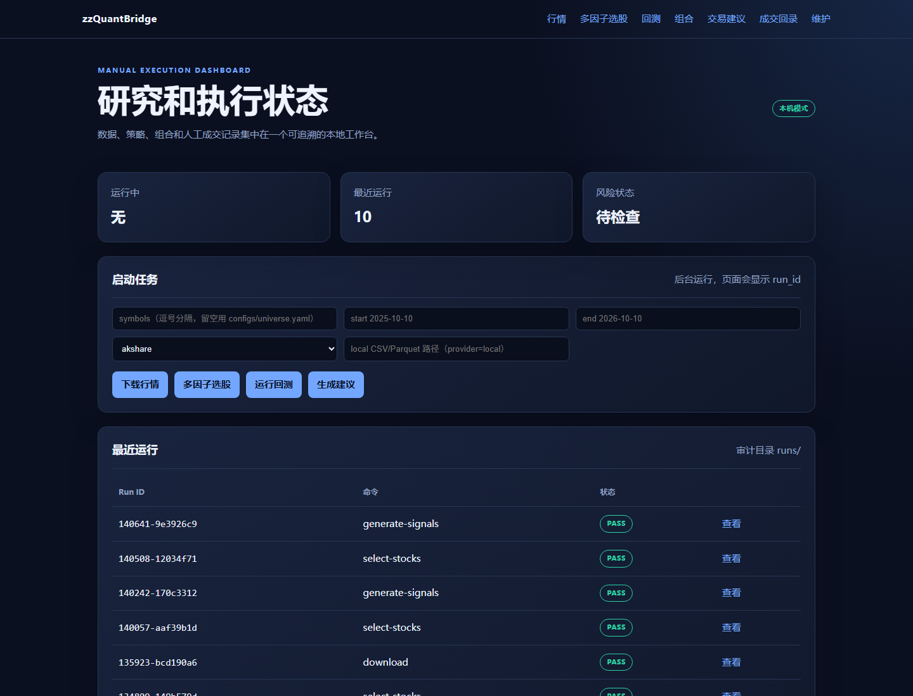
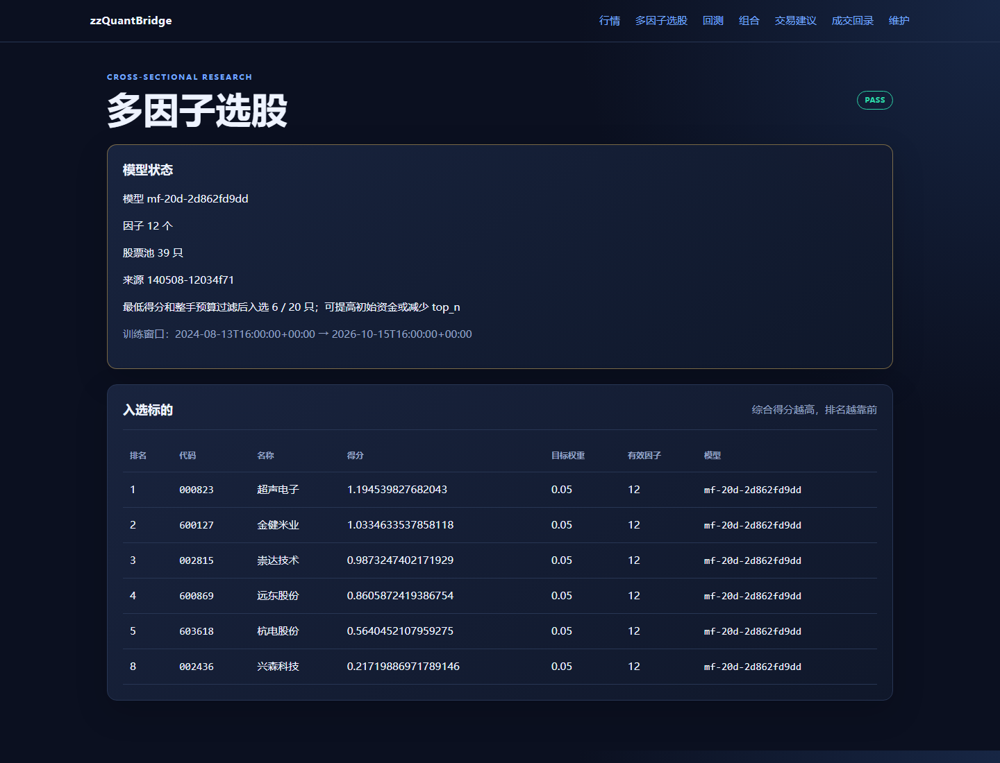
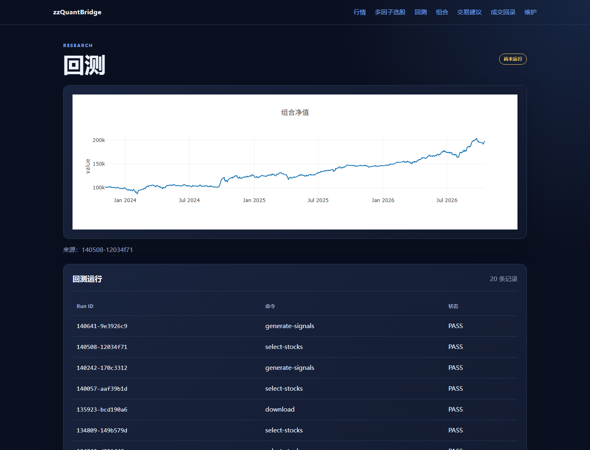

# zzQuantBridge

面向个人研究与人工执行的 A 股量化工具。项目负责行情获取与校验、策略回测、多因子选股、风险检查、组合对账和交易建议生成；不连接券商，也不自动下单。

## 界面预览

以下截图基于本地示例数据，仅用于展示功能。Web 首页集中展示最近运行记录，并可直接触发下载、选股、回测和建议生成。



多因子选股页面展示模型状态、入选股票、综合得分和目标权重。



回测页面展示组合净值曲线和最近的回测运行记录。



## 快速开始

需要 Python 3.11 或更高版本。

```bash
python -m pip install -e ".[data,backtest,web,test]"
python -m quant.server --host 127.0.0.1 --port 8000
```

浏览器打开 <http://127.0.0.1:8000/>。行情页可在右上角切换快照中的股票，也可以直接访问 `/market?symbol=600000`。Web 端默认同一时间只运行一个下载、回测或建议任务；成交回录需要先预览、再确认写入。

## 常用流程

### 准备行情

在线下载默认使用 AkShare，并在多个上游端点之间自动重试。单个端点返回非法 OHLC 时会尝试备用端点；如果某只股票最终下载失败，会记录到 `download_failures.json`，不中断其他股票：

```bash
python -m quant download \
  --config configs/multifactor.yaml \
  --adjustment qfq \
  --start 2021-10-01 \
  --end 2026-10-18
```

离线复现时可改用本地快照：

```bash
python -m quant download \
  --provider local \
  --file snapshot.csv \
  --config configs/universe.yaml
```

检查 CSV 或 Parquet 行情质量：

```bash
python -m quant validate-data --file data/processed/sample.csv --symbols 600000
```

### 均线策略

```bash
python -m quant backtest --config configs/strategy.yaml
python -m quant generate-signals --config configs/strategy.yaml
```

### 多因子选股

多因子流程建议准备至少 5 年的前复权日线数据。`all_a` 模式下，如果当前快照不存在、股票数量不足、历史长度不够，或数据尚未覆盖最近一个完整交易日，`select-stocks` 会自动下载全市场候选池后再选股。交易日按 A 股日历和 15:00 收盘时间判断，周末和节假日不会误触发刷新；已有合格快照会直接复用。自动下载默认覆盖约 5 年数据，可在 `configs/multifactor.yaml` 中设置 `universe.auto_download: false` 关闭。

```bash
python -m quant select-stocks --config configs/multifactor.yaml
python -m quant backtest --config configs/multifactor.yaml
python -m quant generate-signals --config configs/multifactor.yaml
```

股票池、因子、滚动训练、Top-N 和调仓规则均在 `configs/multifactor.yaml` 中配置。模型定义、执行价口径与已知限制见 [多因子模型说明](docs/multifactor-model.md)。

多因子研究默认按股票隔离缺失数据问题：单只股票超过缺失阈值时写入 `quality_exclusions.csv` 并从本次训练剔除，其余股票继续处理。非法 OHLC、重复 bar 等结构性错误仍会阻断运行。

### 回录成交

```bash
python -m quant reconcile \
  --file fills.csv \
  --db db/portfolio.sqlite \
  --initial-cash 100000
```

成交 CSV 至少包含 `trade_id,symbol,side,quantity,price,fee,executed_at`。导入按 `trade_id` 幂等，组合状态以成交账本为准。

## 运行产物

每次命令都会创建 `runs/<date>/<run_id>/`，并写入 `input_manifest.json` 和 `run.log`。新运行 ID 使用 `YYYYMMDD-HHMMSS-操作-随机后缀` 格式，例如 `20261024-195252-select-stocks-a1b2c3`；任务完成后通过 `status.json` 记录 `PASS`、`BLOCKED` 或 `ERROR`，业务任务通常还会生成 `report.html`。按任务不同，还会生成：

- 数据：`data_quality.json`
- 回测：`backtest_metrics.json`、`equity_curve.csv`、`trades.csv`、`sensitivity.json`
- 建议：`signals.csv`、`orders.csv`、`risk_report.json`、`portfolio_snapshot.json`
- 选股：`factor_snapshot.csv`、`factor_weights.csv`、`selections.csv`、`model_metadata.json`

## 安全边界

- 策略只输出目标仓位，风险检查通过后才生成交易建议；检查失败时标记为 `BLOCKED`。
- 建议、订单和实际成交分别保存，建议不会被当作成交。
- 多因子建议优先使用未复权执行价；缺少明确执行价时会阻断。
- 原始行情只追加，运行输入、配置和输出均可追溯。
- `python -m quant clear-history` 默认只预览；确认后加 `--yes` 才会删除。可用 `--runs`、`--data` 或 `--db` 限定清理范围。

## 配置与文档

- 配置：`configs/universe.yaml`、`strategy.yaml`、`risk.yaml`、`multifactor.yaml`
- 模型说明：[多因子模型](docs/multifactor-model.md)
- 架构决策：[docs/adr/](docs/adr/)
- 项目规划：[vectorbt-manual-execution-plan.md](vectorbt-manual-execution-plan.md)

本项目仅用于量化研究、回测和人工交易辅助，不构成投资建议。
